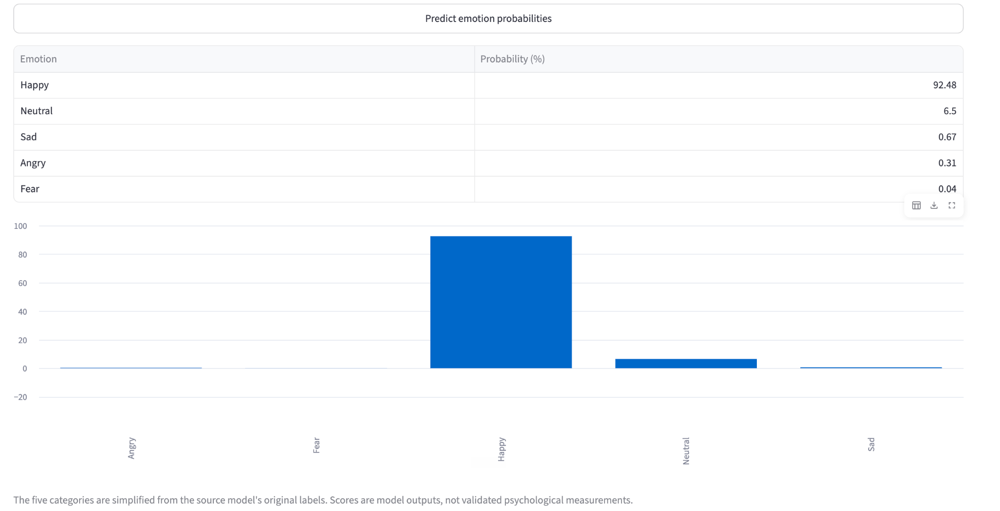

# 🛡️ HateShield AI

**An experimental AI-powered speech and text analysis portfolio project.**

HateShield AI combines audio transcription, text-based hate-speech screening, experimental emotion classification, and anonymous speaker grouping in a Streamlit application.

> **Important:** This is a learning and portfolio prototype, not a production moderation or forensic system. Predictions can be wrong. Always review the original audio, transcript, and context. Never use automated outputs as the sole basis for moderation, employment, disciplinary, or other consequential decisions.

## Features

- **Audio transcription:** Upload WAV, MP3, or M4A audio and transcribe it with Faster-Whisper.
- **Automatic language detection:** Displays the detected language and Whisper's language-probability estimate.
- **Transcript exports:** Download the recognised transcript as TXT or PDF.
- **Hate-speech screening:** Classifies text into Hate Speech, Offensive Language, or Neither using a TF-IDF + Logistic Regression model.
- **Context checks:** Applies limited rule-based checks to selected reporting and group-directed language patterns. These checks are heuristic and require human review.
- **Experimental emotion analysis:** Uses an English-focused transformer model to display simplified emotion scores. Non-English audio is translated to English for this separate estimate; the original transcript is preserved.
- **Speaker grouping:** Uses SpeechBrain speaker embeddings to estimate anonymous speaker labels and produce a speaker-labelled transcript.
- **Speaker transcript export:** Download the diarized transcript as TXT.

## Application screenshot

The screenshot below shows the emotion-analysis output from a test run, including the probability table and bar chart.



*These scores are model outputs, not validated psychological measurements. The five displayed categories are simplified from the source model's original labels.*

## Demo testing output

The following is an example output from a project test run. It is included to demonstrate the app's output format; it is **not a benchmark or ground-truth evaluation**.

### Transcript and language detection

| Field | Observed output |
|---|---|
| Detected language code | `fr` |
| Whisper language probability (estimate) | 57.7% |
| Whisper segment score | 71.6% |

The Whisper segment score is a rough score derived from segment log-probabilities. It is **not transcription accuracy** and is not a calibrated confidence measure.

### Hate-speech screening

| Field | Observed output |
|---|---|
| Final screening result | **Neither** |
| Original model prediction | Neither |

### Experimental emotion output

| Emotion | Model score |
|---|---:|
| Happy | 92.48% |
| Neutral | 6.50% |
| Sad | 0.67% |
| Angry | 0.31% |
| Fear | 0.04% |

These are model scores, not verified emotional states or measurements of a person's intentions.

### Speaker grouping

- Speaker grouping completed.
- Estimated speaker labels: **1**.
- A speaker-labelled transcript was generated.
- Speaker labels are estimates and should be checked against the audio.

### Model evaluation

The current three-class text model was trained using the Davidson hate-speech/offensive-language dataset with TF-IDF features and Logistic Regression.

The reported held-out accuracy from the training run was approximately **87.47%**. Accuracy alone does not describe performance on every class. In that evaluation, the Hate Speech class had lower precision and recall than the other classes, so results should be treated as experimental and reviewed by a person.

**Language limitation:** The text classifier was trained on an English-language dataset. Do not interpret its prediction on French or other non-English transcripts as a reliable language-specific screening result. The example `Neither` prediction above is recorded as an observed app output, not a validated French classification.

## Technology stack

- Python
- Streamlit
- Faster-Whisper
- SpeechBrain / ECAPA speaker embeddings
- Transformers (English emotion model)
- scikit-learn
- TF-IDF Vectorizer
- Logistic Regression
- Pandas, NumPy, Matplotlib
- ReportLab

## Repository structure

```text
HateShield_AI/
├── app.py
├── hate_speech_model.pkl       # Add this model artifact
├── label_mapping.pkl           # Add this label mapping
├── requirements.txt
├── runtime.txt
├── README.md
├── .gitignore
└── .streamlit/
    └── config.toml
```

The two `.pkl` files are required for text screening. They are not included in this source bundle because the trained artifacts must be copied from the Colab session where they were generated.

## Run locally

Use Python 3.11 in a virtual environment.

```bash
python -m venv .venv
```

Activate it:

**Windows**
```bash
.venv\Scripts\activate
```

**macOS / Linux**
```bash
source .venv/bin/activate
```

Install dependencies:

```bash
python -m pip install --upgrade pip
pip install -r requirements.txt
```

Place `hate_speech_model.pkl` and `label_mapping.pkl` in the project root, then start the app:

```bash
streamlit run app.py
```

Open the local URL shown by Streamlit (normally `http://localhost:8501`).

The first use of transcription, emotion analysis, and speaker grouping downloads their pretrained model files. Initial startup and first inference can therefore take longer and require an internet connection.

## Deploy on Streamlit Community Cloud

1. Create a GitHub repository, for example `hateshield-ai`.
2. Upload `app.py`, `requirements.txt`, `runtime.txt`, `README.md`, `.gitignore`, and `.streamlit/config.toml`.
3. Copy `hate_speech_model.pkl` and `label_mapping.pkl` from the Colab session into the repository root. The current model artifact is about 3.2 MB, so it is below GitHub's 100 MB per-file limit.
4. Push the repository to GitHub.
5. Open [Streamlit Community Cloud](https://share.streamlit.io/), sign in with GitHub, and choose **Create app**.
6. Select the repository, branch, and `app.py` as the main file.
7. Deploy and wait for dependency installation and model downloads to finish.

### Important deployment notes

- Streamlit Community Cloud has finite CPU, memory, and storage. Audio transcription and speaker grouping can be slow on a free CPU instance.
- The app downloads Whisper, emotion, and speaker-embedding models on first use; this increases initial startup/inference time.
- If the deployment fails during dependency installation or runs out of memory, inspect the Streamlit app logs before changing versions or removing features.
- The app uses repository-relative paths for the two classifier artifacts. Do not put them in `/content`; that path is specific to the Colab environment.
- Do not commit private audio recordings, access tokens, or personal data.

## Limitations and responsible use

1. The hate-speech classifier is a portfolio baseline trained on an English-language dataset. It is not a multilingual hate-speech model.
2. The model's overall accuracy does not guarantee reliable detection of the minority Hate Speech class.
3. Context checks are simple rules, not semantic understanding or intent detection.
4. Whisper can misidentify languages or words, especially with short, noisy, accented, or mixed-language recordings.
5. The displayed Whisper segment score is not transcription accuracy.
6. Emotion analysis is experimental, text-based, English-focused, and not a measurement of actual feelings.
7. Speaker grouping is an estimate. Short clips, overlapping speech, noise, and similar voices can cause errors.
8. The application is intended for demonstration and learning. Human review is required.

## Dataset and model notes

The text classifier uses the Davidson hate-speech and offensive-language dataset (`labeled_data.csv`) with the `tweet` text and `class` label fields. The three classes are:

- `0` — Hate Speech
- `1` — Offensive Language
- `2` — Neither

The model pipeline uses a TF-IDF vectorizer with unigrams and bigrams and Logistic Regression with balanced class weights.

## License

Add a license file only after confirming the licensing terms for the dataset, pretrained models, and any code incorporated into this project. This repository does not grant rights to third-party datasets or pretrained model weights.
